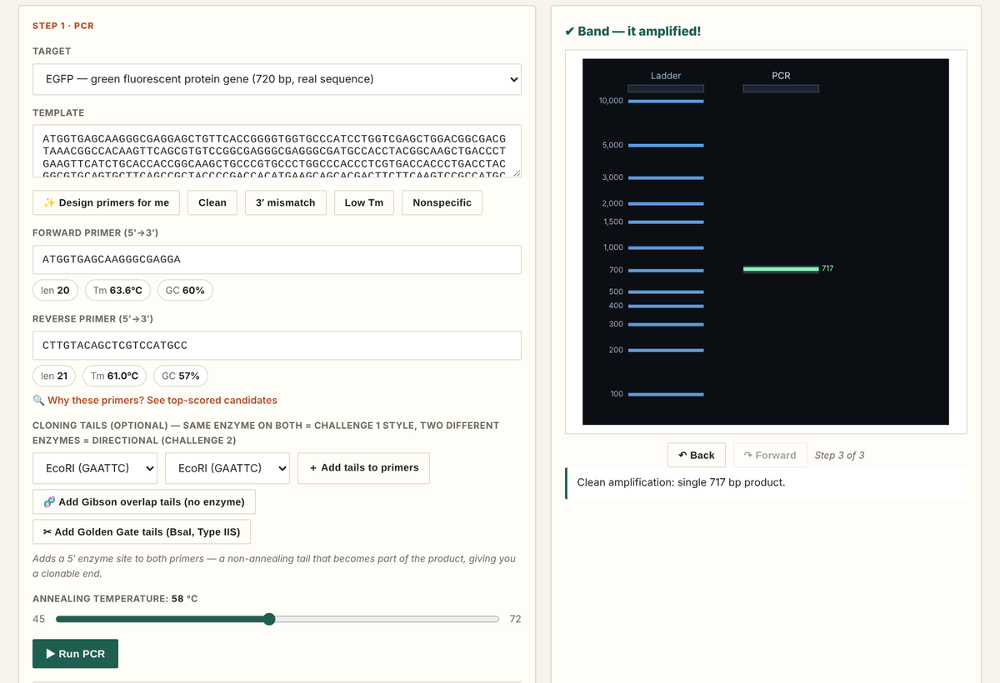

# Biotech Sandbox

**Run real lab experiments in your browser.**

Design primers, run a PCR, see the band on a gel, clone it, sequence it and break things on purpose to find out why experiments fail. Every result comes from real biochemistry calculated live in the page, not from a script.

This is the first piece of a larger idea: a learn-by-doing platform, in the spirit of Kaggle, where enthusiasts learn and compete on hands-on biotech challenges.



## Try it

- **Online:** [mmojtabavi.github.io/Biotech_Sandbox](https://mmojtabavi.github.io/Biotech_Sandbox/)
- **Locally:** download the repo and open `pcr-lab.html` in any modern browser. No install, no server and no internet connection needed.

## What's inside

**How it's organized:** the app is one long page. At the top, **lessons** explain a concept and tell you what to try. Below them, **9 lab steps** are the hands-on stations where you actually run experiments. **Challenges** are scored tasks that use the same steps. Several steps also have an alternative method, marked with ′ or ″ (for example, 3′ Gibson assembly).

**9 guided lessons and the steps they use**

| Lesson | Steps used |
|---|---|
| 1 · How PCR works | 1 |
| 2 · Specificity & restriction digest | 2 |
| 3 · Ligation & cloning | 1 → 2 → 3 (plus 3′ Gibson, 3″ Golden Gate) |
| 4 · qPCR: quantifying, not just detecting | 1 → 7 |
| 5 · ELISA: measuring by binding, not amplifying | 7 → 8 |
| 6 · Splicing: one gene, two versions of the message | 4 |
| 7 · CRISPR/Cas9: cutting DNA at a chosen address | 1 → 2 → 3 → 9 |
| 8 · Sequencing: did your experiment really work? | 5 (Sanger), 5′ (NGS) |
| 9 · Protein analysis: is your protein the right size? | 4 → 6 (SDS-PAGE), 6′ (HPLC) |

**3 scored challenges:** clone-ready EGFP, directional (two-enzyme) cloning, and designing the most specific primer set.

**The 9 lab steps, from gene to protein**

| Step | What you do |
|---|---|
| 1 · PCR | Design or auto-pick primers, set the annealing temperature, run the reaction, read the gel |
| 2 · Restriction digest | Cut the product with one or two enzymes (EcoRI, BamHI, HindIII and more) |
| 3 · Cloning | Restriction/ligation cloning; alternatives 3′ Gibson assembly and 3″ Golden Gate (BsaI, Type IIS) |
| 4 · Transcription & translation | mRNA, open-reading-frame finding, protein sequence |
| 5 · Sequencing | Sanger read-out to verify the clone; alternative 5′ NGS-style short-read coverage |
| 6 · Protein analysis | SDS-PAGE molecular-weight gel; alternative 6′ estimated HPLC retention time |
| 7 · qPCR | Amplification curves, Ct values, standard curve, melt curve |
| 8 · ELISA | Antibody–antigen binding curves |
| 9 · CRISPR/Cas9 | Guide RNA design and scoring |

**Real sequences:** EGFP (GenBank U55762), lacZα (pUC19) and ubiquitin, plus random practice templates.

**Under the hood**
- Nearest-neighbor (SantaLucia) melting temperatures, calibrated against primer3
- Primer binding with 3′-extension rules, primer-dimer and hairpin checks, and specificity scoring
- Logistic qPCR kinetics with an ordinary-least-squares standard curve
- A save-and-share code, a downloadable lab report, FASTA export, undo/redo, a guided tour, light/dark themes, a colorblind-safe palette and a mobile layout

## Repository layout

```
pcr-lab.html        the complete app (single file, no dependencies)
index.html          redirects to pcr-lab.html (for GitHub Pages)
tests/              Node + jsdom test suites, one per feature (~560 checks)
python/             Python reference PCR engine and gel renderer (uses primer3)
docs/               concept and feasibility notes, images
```

## Running the tests

```bash
npm install          # installs jsdom
npm test             # runs every suite in tests/
```

Python reference engine:

```bash
cd python
pip install -r requirements.txt
python test_pcr.py
python demo.py       # renders virtual_gel.png
```

## Roadmap

- More scored challenges, for example CRISPR guide scoring
- GenBank (`.gb`) export
- User accounts, leaderboards and community challenges: the "compete" part

## License

[MIT](LICENSE)
